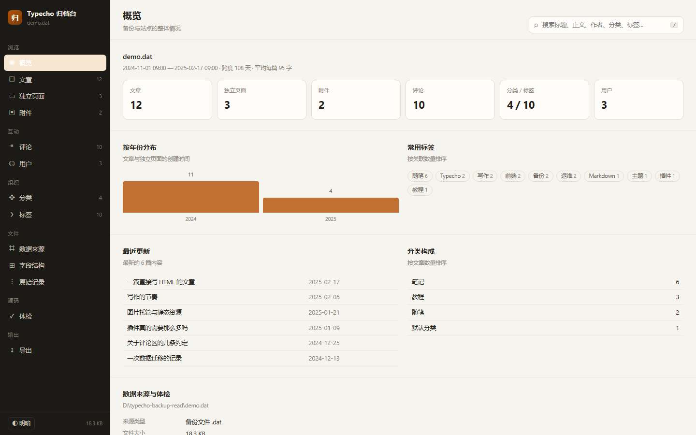
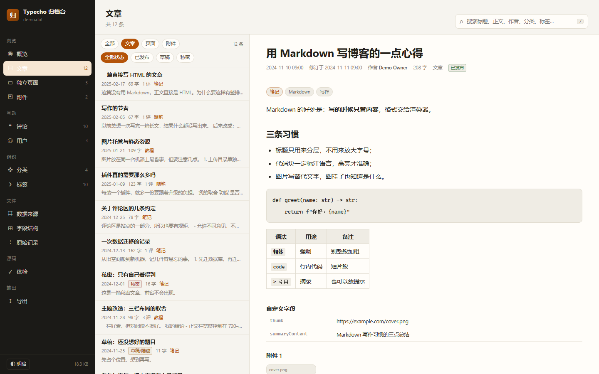
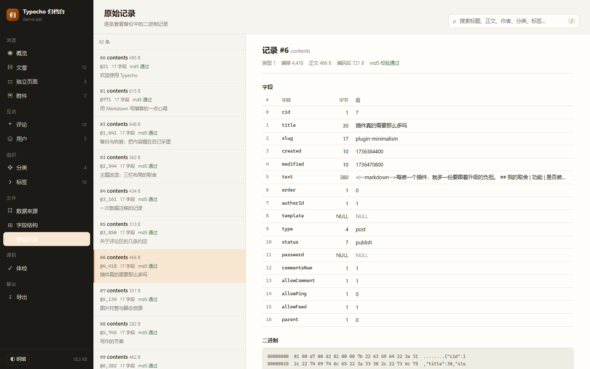
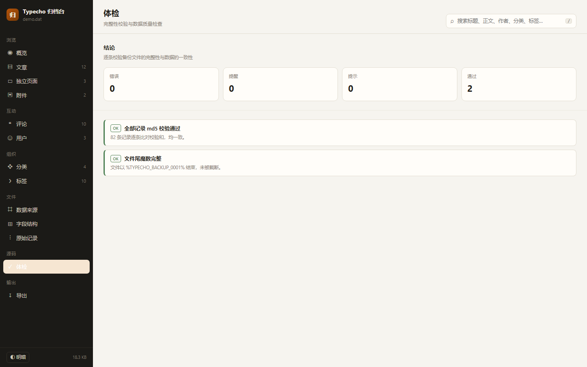
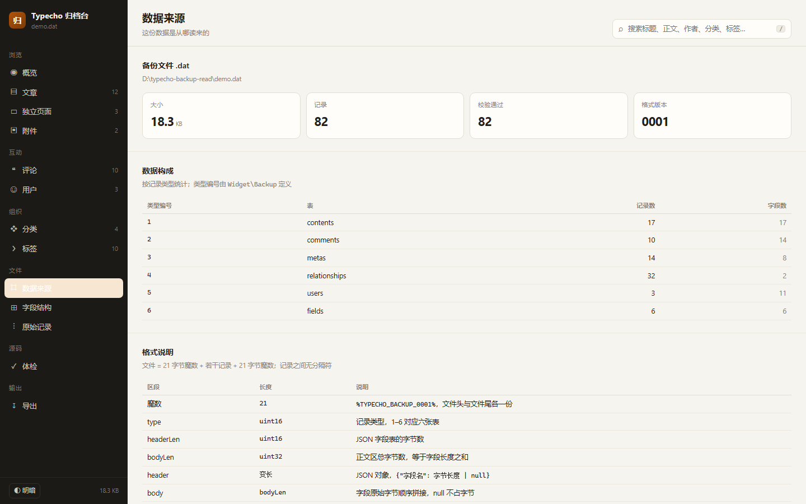

# Typecho Archive Studio

**Read Typecho `.dat` backups and site archives offline.** Turn them into something you can
browse, search, verify and take away.

No third-party dependencies — pure Python standard library. It never connects to your database
and never modifies the files you give it.

[简体中文](README.md) · **English**



---

## Why

Typecho's built-in backup exports **content data only**, into a custom binary `.dat`: no table of
contents, no record separators, field lengths hidden in a per-record JSON header. It is built for
"import and restore", not for "open and look". The source archive (site tar + SQLite database) is
readable, but only if you are comfortable writing SQL.

This tool just reads both of them into something you can understand.

The format itself is documented byte by byte in [`docs/format.md`](docs/format.md) (in Chinese),
including a minimal parser you can copy.

## What it does

| | |
|---|---|
| **Auto-detects input** | `.dat`, `.tar.gz`, `.tar`, `.zip`, an extracted directory, or `.db`. Drag either file — they do not need to come in pairs |
| **Browse & search** | Posts, pages, attachments, comments, categories, tags, users; full-text search with filters |
| **Renders content** | Built-in Markdown renderer; raw HTML inside `!!!` fences renders as real components, with `<style>` injected under a `.prose` scope |
| **Single-article export** | Save the open article as a self-contained HTML (images inlined, comments included, works offline) or as Markdown with front matter |
| **Integrity report** | Per-record md5, footer magic, orphan comments, duplicate slugs, missing uploads, stale category counters — each with concrete ids |
| **Two-way diff** | Give both a backup and a source archive and it lists, per primary key, what exists only on one side |
| **Raw records** | For any record: field table, hex dump, md5 status — the page you want when writing your own parser |
| **Exports** | Markdown with front matter, rebuilt SQLite, full JSON, per-table CSV, single-file offline report |

## Quick start

### Windows: double-click

Drag **either** a `.dat` backup, a source archive, or a `.db` onto `启动归档台.cmd`.
An app-style window opens (no address bar, no tabs); closing it stops the server.

Double-clicking the launcher also works — it opens a file dialog. Use
`启动归档台(无窗口).vbs` if you prefer no console window.

Interpreter lookup order: `%TARCH_PYTHON%` → `runtime\python.exe` → `py -3` → `python`.

### Command line

```bash
python -m typecho_archive serve backup.dat
python -m typecho_archive serve site-archive.tar.gz
```

### Try it without your own data

```bash
python -m typecho_archive demo          # writes demo.dat with fictional content
python -m typecho_archive serve demo.dat
```

### Share a single-file report

```bash
python -m typecho_archive report backup.dat -o archive-report.html
```

Roughly 2 MB of self-contained HTML — styles, scripts and data inlined. The recipient just
double-clicks it. No Python, no network.

## Screenshots

| Article | Raw records |
|---|---|
|  |  |

| Integrity | Data source |
|---|---|
|  |  |

## Two data sources

| Input | Where the data comes from | UI difference |
|---|---|---|
| `*.dat` | Parsed binary backup | Shows raw records & field layout; hides site info |
| `*.tar.gz` / `.zip` / directory | Site tree + **the bundled `typecho.db`** | Shows site info; hides raw records |
| `*.db` | SQLite directly | Same as above, without archive-level metadata |

Both go through the same column whitelist (`contents` 17 columns, `comments` 14, …), so extra
columns added by themes (`views`, `likes`, …) are ignored and everything downstream — stats,
integrity, exports, UI — is identical regardless of the source.

Only the diff needs both files: `python -m typecho_archive diff backup.dat -s site.tar.gz`.

## CLI reference

`<data>` can be a `.dat`, a source archive, or a `.db`.

| Command | Purpose |
|---|---|
| `info <data> [-s src]` | Counts, time span, integrity summary |
| `list <data> [-t post,page] [-S publish] [-c cat] [-g tag] [-q kw]` | List content |
| `show <data> <cid>` | Print one item with its comments |
| `search <data> <kw>` | Full-text search, ranked by hit count |
| `verify backup.dat [--rebuild out.dat]` | Per-record md5; `--rebuild` proves byte-exact reconstruction |
| `inspect backup.dat [-r N]` | Record layout; with `-r`, field table plus hex dump |
| `export <data> -o dir -f all\|markdown\|sqlite\|json\|csv\|html [--zip]` | Batch export |
| `report <data> [-s src] -o report.html` | Single-file offline report |
| `source <archive>` | Inspect a source archive only |
| `diff backup.dat -s src` | Two-way diff |
| `serve [data] [-s src] [-p port] [--no-open]` | Open the UI |
| `selfcheck [data]` | 10 end-to-end assertions |
| `demo [out]` | Generate synthetic demo data |

`--json` on `list` / `show` gives structured output for scripting.

## Install

Python 3.10+, no third-party packages.

```bash
git clone https://github.com/Yamanaka-Ame/typecho-archive.git
cd typecho-archive
python -m typecho_archive demo
```

Or install the console script:

```bash
pip install .
typecho-archive serve demo.dat
```

## Design notes

**The format is parsed, not guessed.** Field lengths live only in each record's JSON header and
records have no separators, so the parser splits strictly by schema and checks md5 per record.
`verify --rebuild` reconstructs the whole archive **byte for byte** — the strongest evidence the
parser is right.

**Source archives vary.** No hard-coded `usr/themes` or `/admin/`: it walks down to find
`config.inc.php`, derives subdirectories from the config constants, expands nested archives
(tar.gz containing a site tar plus a `typecho.db`), and locates the database by the configured
path, falling back to filename.

**Two sources, one model.** A `.dat` record and a SQLite row both become the same `Record`
structure, aligned by the backup's column whitelist.

**One UI, two modes.** The server mode fetches JSON; the static mode inlines the same payload into
HTML. The frontend only looks at `window.__MODE__`, so the offline report and the desktop app feel
the same.

**Embedded components render — without leaking.** Many people drop raw HTML into posts behind a
`!!!` marker (copyright cards, tables of contents, custom tables), sometimes with a `<style>`
block that later components rely on. Those blocks are rendered as HTML rather than escaped, and
any `<style>` they contain is collected and injected once for the whole article with every rule
prefixed by `.prose` — so a global `table { }` cannot restyle the rest of the app. `<script>` and
inline handlers are stripped.

## Privacy

A backup contains **everything about a real site**: posts, comments, email addresses, IPs, user
agents, and password hashes (the tool only shows whether one exists; it never exports or cracks it).

- This repository ships **no real site data**; screenshots and tests use `demo` output;
- `.gitignore` excludes `*.dat`, `*.db`, `*.tar.gz`, `*.zip` — check `git status` before committing;
- The tool is read-only and makes no network requests beyond `127.0.0.1`.

## Limitations

- Implements `%TYPECHO_BACKUP_0001%`; unknown versions are reported and parsed with 0001 rules.
- The backup has no `options` table, so site title/theme/routes come only from the source archive.
- With a source archive, data is the `typecho.db` snapshot at packaging time — not necessarily the
  same moment as the backup.
- Attachment previews need the source archive; the offline report contains no images.
- The GUI layer (app window, file dialogs, launchers) targets Windows; parsing and exporting are
  cross-platform.

## Development

```bash
python -m unittest discover -s tests -v
```

12 tests: deterministic demo output, parse counts, **byte-exact rebuild**, truncated-file handling,
invalid input rejection, model stats, integrity, payload serialisation, SQLite export round-trip,
Markdown export, static report generation. No real data required.

### Render check (needs real data, optional)

The Markdown renderer is hand-written and block boundaries are decided in several places — that
has produced hangs, components rendered as source text, styles not applying, HTML blocks split by
blank lines. Eyeballing one post cannot catch that class, so there is a browser-driven sweep:

```bash
python tools/render_check.py backup.dat -j 4
```

It renders every post in the archive through headless Edge and asserts: finishes within a timeout
(no infinite loops), renders a title, no escaped block tags in the body, no leftover `!!!` markers,
and every injected `<style>` rule is scoped. 245 posts take ~5 minutes.

## License

[MIT](LICENSE)
