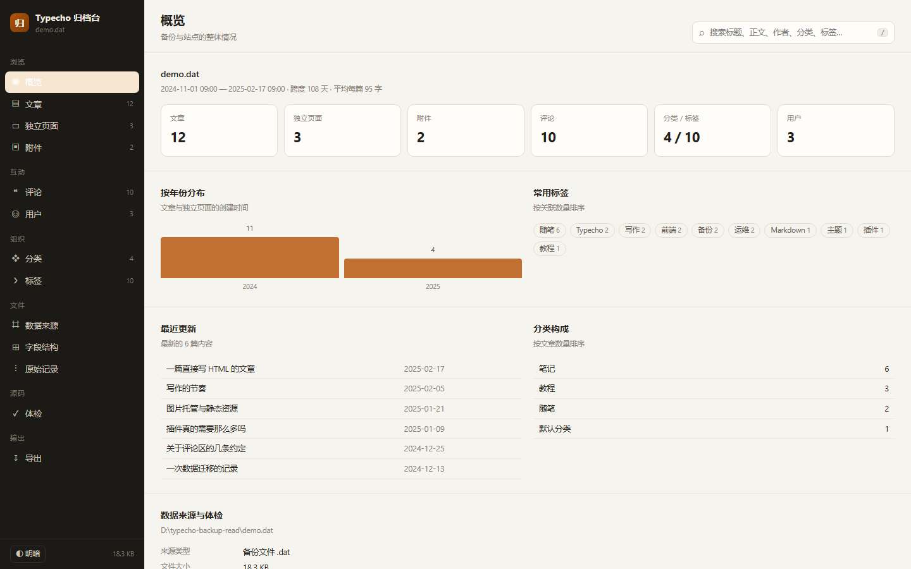
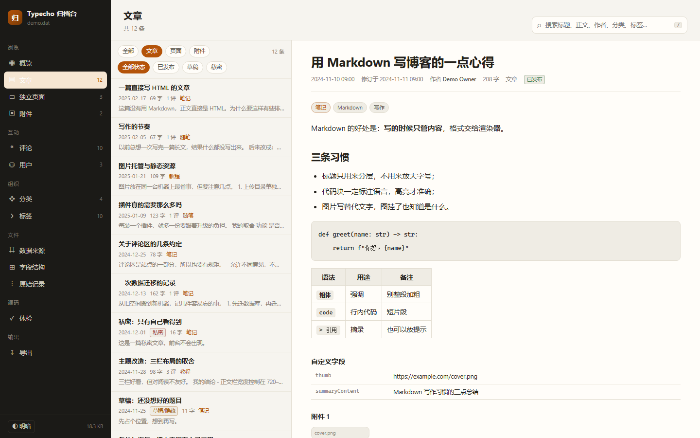
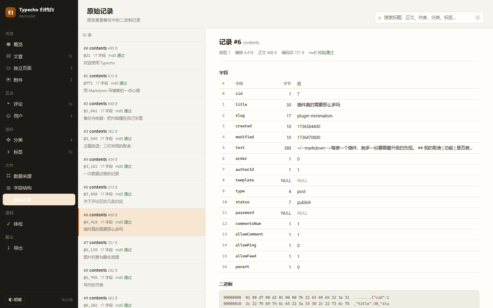
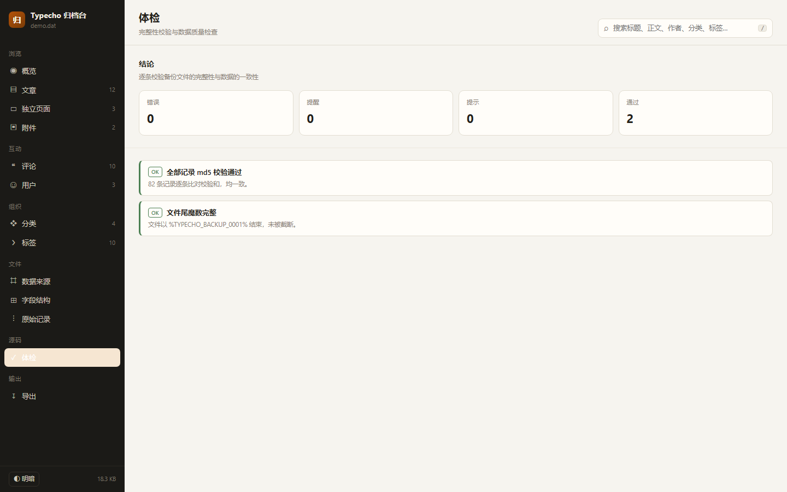

# Typecho 归档台

读取 Typecho 的 **`.dat` 备份文件**与**站点源码包**，把文章、评论、分类标签、用户和站点配置
还原成一个可检索、可体检、可导出的桌面工具。

零第三方依赖，只用 Python 标准库；不会连接你的数据库，也不会改动任何原始文件。

<a href="README.en.md">English</a> · **简体中文**



---

## 为什么做这个

Typecho 的备份只导出**内容数据**，存成一个自定义的二进制 `.dat`：没有表头目录、记录之间
没有分隔符、字段长度藏在每条记录自带的 JSON 里。它适合「导进去恢复」，但不适合「拿出来看」。
而源码包（站点 tar + SQLite 库）倒是能看，可你得先会写 SQL。

这个工具做的事很简单：**把这两个文件都读成能看懂、能搜索、能带走的东西。**

顺带把格式本身也摸清楚了，`docs/format.md` 里有逐字节说明和最小解析器代码。

## 它做什么

| 能力 | 说明 |
|---|---|
| **自动识别输入** | `.dat` / `.tar.gz` / `.tar` / `.zip` / 解压后的目录 / `.db`，拖进去就行，两个文件不必成对 |
| **浏览与检索** | 文章、独立页面、附件、评论、分类标签、用户，全文搜索 + 按状态/时间/标签筛选 |
| **正文还原** | 自己实现的 Markdown 渲染器；`!!!` 围栏里的原生 HTML 直接渲染成组件，`<style>` 注入时自动限定作用域 |
| **单篇另存** | 文章页一键存成独立 HTML（图片内联、含评论，离线可看），或带 front matter 的 Markdown |
| **完整性体检** | 逐条 md5、文件尾魔数、孤儿评论、重复缩略名、缺失附件、分类计数偏差，逐项列出具体 id |
| **两边对账** | 同时给出备份与源码库时，按主键比对，列出「只在这一边存在」的每一条 |
| **原始记录** | 任意一条记录都能看到字段表、十六进制转储和 md5 状态——想自己写解析器时最有用 |
| **多种导出** | Markdown（带 front matter）、重建 SQLite、完整 JSON、逐表 CSV、单文件离线报告 |

## 快速开始

### 一、双击启动（Windows）

把**任意一个**文件（`.dat` 备份、源码包，或 `.db`）**拖到 `启动归档台.cmd` 上**，
就会打开一个没有地址栏、没有标签页的独立窗口；关掉窗口，后台服务随之退出。

直接双击 `启动归档台.cmd` 也可以，会弹出文件选择框。
嫌黑框难看就用 `启动归档台(无窗口).vbs`。

启动器会按这个顺序找 Python：`%TARCH_PYTHON%` → `runtime\python.exe` → `py -3` → `python`。
想做成完全独立的绿色版，把一份 Python 运行时放进 `runtime\` 即可。

### 二、命令行

```bash
python -m typecho_archive serve 备份.dat
python -m typecho_archive serve 站点源码包.tar.gz
```

### 三、先试一下，不用自己的数据

```bash
python -m typecho_archive demo          # 生成 demo.dat（全虚构内容）
python -m typecho_archive serve demo.dat
```

### 四、生成单文件报告分享给别人

```bash
python -m typecho_archive report 备份.dat -o 归档报告.html
```

产出约 2 MB 的 HTML，样式、脚本、数据全部内联，对方双击即可阅读，不需要装 Python、不需要联网。

## 界面

| 概览 | 正文 |
|---|---|
|  |  |

| 原始记录（格式逆向） | 体检 |
|---|---|
|  |  |

`/` 聚焦搜索框，`Esc` 清空，左下角切换明暗主题，地址栏哈希可以直接定位到某篇文章。

打开一篇文章后，右上角有 **下载 HTML / Markdown**：

- **HTML**：单篇自成一体，图片转成 data URI 内嵌，带上评论，发给别人双击就能看；
  配色跟随你当前的明暗主题，不看系统偏好。
- **Markdown**：front matter 与批量导出的格式完全一致，可以直接丢进同一个文件夹。

## 两种数据来源

两个文件只需要给其中一个，工具按内容自动识别：

| 你手上的文件 | 数据从哪来 | 界面变化 |
|---|---|---|
| `*.dat` | 解析二进制备份 | 有「原始记录」「字段结构」，隐藏「站点信息」 |
| `*.tar.gz` / `.zip` / 目录 | 提取站点结构 + **直接读包内的 `typecho.db`** | 有「站点信息」，隐藏「原始记录」「字段结构」 |
| `*.db` | 直接读数据库 | 同上，但没有源码包层面的信息 |

两者都由同一套字段白名单对齐（`contents` 17 列、`comments` 14 列……），数据库里多出来的
扩展列（比如某些主题加的 `views`、`likes`）自动忽略，所以统计、体检、导出、
界面完全不需要知道数据从哪来。

只有「两边对账」需要同时给两份：`python -m typecho_archive diff 备份.dat -s 源码包.tar.gz`。

## 命令行参考

下表中的 `<数据>` 可以是 `.dat`、源码包或 `.db`；`-s 源码` 是可选的附加信息。

| 命令 | 作用 |
|---|---|
| `info <数据> [-s 源码]` | 概况：数量、时间跨度、体检提示 |
| `list <数据> [-t post,page] [-S publish] [-c 分类] [-g 标签] [-q 关键词]` | 列出内容 |
| `show <数据> <cid>` | 输出单篇正文与评论 |
| `search <数据> <关键词>` | 全文搜索，按命中次数排序 |
| `verify 备份.dat [--rebuild 输出路径]` | 逐条 md5 校验；`--rebuild` 重建并比对是否逐字节一致 |
| `inspect 备份.dat [-r 序号]` | 看记录结构；指定序号时输出字段表与十六进制 |
| `export <数据> -o 目录 -f all\|markdown\|sqlite\|json\|csv\|html [--zip]` | 批量导出 |
| `report <数据> [-s 源码] -o 报告.html` | 单文件离线报告 |
| `source 源码包` | 只看源码包信息，不读文章数据 |
| `diff 备份.dat -s 源码` | 两边对账 |
| `serve [数据] [-s 源码] [-p 端口] [--no-open]` | 打开图形界面；省略路径则弹出选择框 |
| `selfcheck [数据]` | 端到端自检，10 项断言（换新备份时先跑这个） |
| `demo [输出路径]` | 生成合成演示数据 |

`list` / `show` 加 `--json` 可输出结构化数据，方便接脚本。

## 安装

需要 Python 3.10+，**无需任何第三方包**。

```bash
git clone https://github.com/Yamanaka-Ame/typecho-archive.git
cd typecho-archive
python -m typecho_archive demo
```

也可以装成命令（可选）：

```bash
pip install .
typecho-archive serve demo.dat
```

## 目录结构

```
typecho-archive/
├─ typecho_archive/
│  ├─ dat.py         .dat 格式的解析与重建（读写都逐字节对齐 PHP 端）
│  ├─ sources.py     数据源抽象：.dat 与 SQLite 统一成同一种记录
│  ├─ model.py       字段类型、枚举中文名、正文处理
│  ├─ store.py       归档模型：索引、统计、体检、对账
│  ├─ source.py      源码包扫描：自适应定位站点根目录与各子目录
│  ├─ export.py      Markdown / SQLite / JSON / CSV 导出
│  ├─ htmlreport.py  单文件离线报告
│  ├─ server.py      本地 HTTP 服务与独立窗口启动
│  ├─ dialogs.py     Windows 文件选择框（不依赖 tkinter）
│  ├─ demo.py        合成演示数据生成器
│  ├─ cli.py         命令行入口
│  └─ ui/            index.html / app.css / app.js（服务端与静态报告共用）
├─ docs/format.md    .dat 格式的逐字节说明
├─ tests/            回归测试（不依赖任何真实数据）
├─ tools/
│  └─ render_check.py  渲染自检：用真实浏览器逐篇校验（需要真实数据）
├─ 启动归档台.cmd
└─ 启动归档台(无窗口).vbs
```

## 设计说明

**格式吃透，不靠猜。** 备份文件的字段长度只存在于每条记录自带的 JSON 里，记录之间没有分隔符，
解析器严格按 schema 切分并逐条核对 md5。`verify --rebuild` 能把整包重建出来并做到
**与原文件逐字节一致**——这是解析正确性最强的证据。

**源码包结构可能变。** 不写死 `usr/themes`、`/admin/` 这类路径：先递归找 `config.inc.php`
定位站点根目录，再从配置常量推导各子目录；压缩包套压缩包会自动展开；数据库文件按配置里的
路径找，找不到再按文件名兜底。

**两种来源，一套模型。** `.dat` 的一条记录和 SQLite 的一行数据都转成同样的 `Record`，
字段按备份白名单对齐。所以「只有备份」和「只有源码包」跑出来的是同一个界面。

**同一套界面跑在两种模式。** 服务端模式通过 API 取数，静态模式把整个 payload 内联进 HTML；
前端只认 `window.__MODE__`，所以离线报告和桌面程序的观感完全一致。

**内嵌组件要真渲染，但不能污染界面。** 很多人在正文里用 `!!!` 分隔符插原生 HTML
（版权卡、目录、自定义表格），也有把 `<style>` 写在这种块里、再给后面组件用的。归档台会
把这类块按 HTML 渲染而不是转义；块里的 `<style>` 收集起来注入整篇文章，并给每条规则加上
`.prose` 前缀——真实文章里有 `table { }`、`th, td { }` 这类全局选择器，不限定范围会把
界面自身样式一起改掉。`<script>` 与内联事件一律剥离。

**体检要能落地。** 不只说「有 N 个问题」，而是列出具体是哪个 cid、哪个缩略名重复、
哪个附件在 `usr/uploads` 里找不到。

## 隐私与安全

备份文件里含**真实站点的一切内容**：文章、评论、邮箱、IP、浏览器标识，以及用户密码的
哈希值（工具只显示「有无」，不导出、不尝试破解）。

- 本仓库不包含任何真实站点数据，截图与测试都用 `demo` 命令生成的虚构内容；
- `.gitignore` 默认排除 `*.dat`、`*.db`、`*.tar.gz`、`*.zip` ——**提交前请确认没有把它们加进暂存区**；
- 工具全程只读，不修改原始文件，也不会把你的数据发到任何地方（本地 127.0.0.1 之外没有网络请求）。

## 已知限制

- 备份格式按 `%TYPECHO_BACKUP_0001%` 实现；遇到 `FILE` 变体或新版本号会提示并按 0001 规则尝试。
- 备份不含 `options` 设置表，站点标题、主题、路由只存在于源码包；只给 `.dat` 时界面会隐藏「站点信息」。
- 只给源码包时，数据来自包里的 `typecho.db`，那是打包那一刻的快照，不一定等于备份那一刻。
- 附件图片需要源码包才能预览；离线报告不包含图片本体。
- 图形界面目前只对 Windows 做了适配（独立窗口、文件对话框、启动器）；核心解析与导出是跨平台的。

## 开发与测试

```bash
python -m unittest discover -s tests -v
```

12 项测试覆盖：演示数据确定性、解析计数、**逐字节重建**、截断文件容错、非法文件拒绝、
模型统计、体检、payload 序列化、SQLite 导出回读、Markdown 导出、静态报告生成。
测试不依赖任何真实站点数据。

### 渲染自检（需要真实数据，可选）

Markdown 渲染器是手写的，块边界判断分散在各个分支里——历史上出过死循环、组件被当文本
转义、样式不生效、HTML 块被空行切碎。这类问题靠人眼抽查发现不了，所以有一个用真实浏览器
逐篇渲染的检查：

```bash
python tools/render_check.py 备份.dat -j 4
```

它会用无头 Edge 把归档里每一篇都渲染一遍，断言：必须限时结束（防死循环）、必须渲染出标题、
正文里不得出现被转义的块级标签、不得残留 `!!!` 标记、注入的 `<style>` 必须全部带作用域。
245 篇大约 5 分钟，改完渲染器跑一遍比抽查靠谱得多。

改启动器之前请先看 `.cmd` 和 `.vbs` 文件头那几条注释——中文 Windows 上那些坑踩过一次就够了。

## 常见问题

**双击没反应 / 一闪而过。**
多半是没找到 Python。在命令行里 `python --version` 确认一下，或者把 Python 装到
`runtime\python.exe`。也可以设置 `TARCH_PYTHON` 指向解释器。

**路径变成方块、提示「找不到这个文件」。**
中文路径要穿过批处理命令行、PowerShell 管道、Python 文件 API 三道关。工具里已经分别处理
（批处理不碰代码页、文件选择框走 UTF-8 临时文件、拿到路径再校验一次）。
如果仍然出问题，用 `启动归档台(无窗口).vbs`，它走 COM 的 Unicode 接口最稳。

**控制台中文乱码。**
Python 会跟随控制台代码页输出。别在外面设 `PYTHONIOENCODING=utf-8`，那会把 UTF-8 灌进
GBK 控制台，反而更乱。

**想看到完整报错。**
设置环境变量 `TARCH_DEBUG=1`，命令行工具会打印真实调用栈；否则只给一句中文提示。

## 许可

[MIT](LICENSE)
